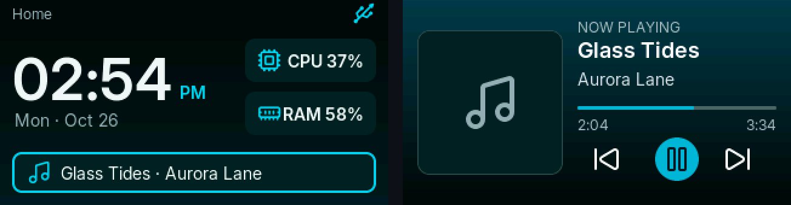
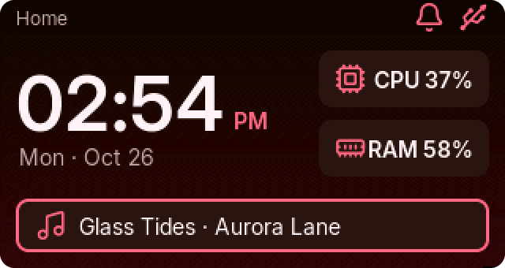
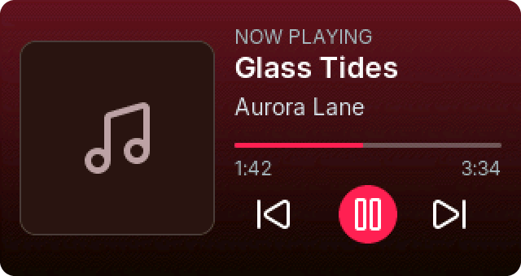
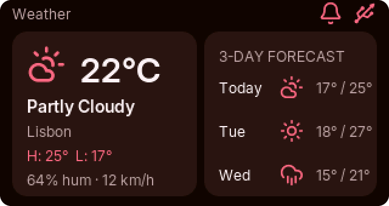
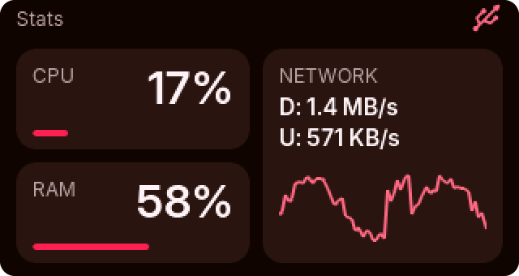
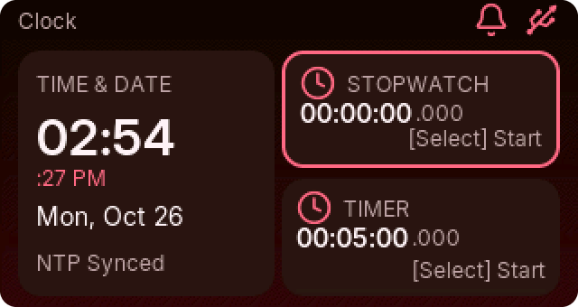
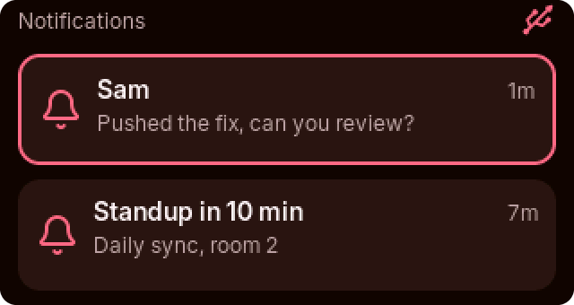
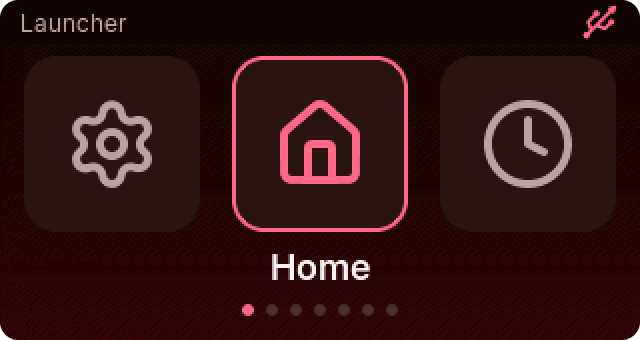
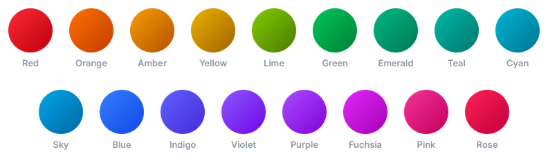
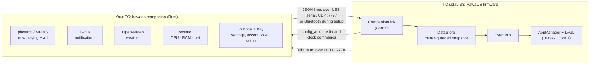

<p align="center">
  
</p>

<h1 align="center">HawaOS</h1>

<p align="center">
  <em>Breezy Elegance, Materialised.</em><br>
  A tiny desktop-dashboard OS for the LilyGo T-Display-S3, paired with a Rust companion on your PC.
</p>

<p align="center">
  
  
  
  
  
</p>

<p align="center">
  
</p>

---

## Screens

<table>
  <tr>
    <td width="50%"><br><b>Home</b>: big clock, CPU and RAM at a glance, the current track</td>
    <td width="50%"><br><b>Now Playing</b>: album-art tinted background, transport controls</td>
  </tr>
  <tr>
    <td><br><b>Weather</b>: current conditions and a 3-day forecast</td>
    <td><br><b>Stats</b>: PC CPU, RAM and a live network sparkline</td>
  </tr>
  <tr>
    <td><br><b>Clock</b>: NTP time, stopwatch and timer, synced with the companion</td>
    <td><br><b>Notifications</b>: your desktop notifications, mirrored</td>
  </tr>
  <tr>
    <td><br><b>Launcher</b>: carousel of every app</td>
    <td valign="top"><br><b>Also on board</b><br>
      Always-on display that dims to a clock and shifts to the album's tint while music plays<br>
      Control Center (press both buttons): brightness, theme, Wi-Fi, AOD<br>
      On-device Settings: accent, theme, orientation, AOD timeout, clock format
    </td>
  </tr>
</table>

<sub>Every image above is a real framebuffer capture from the device.</sub>

## Make it yours

Pick one of **17 Tailwind accents** from the companion, its tray menu or on-device Settings. The choice syncs both ways. In dark mode the whole UI takes on the accent: the wallpaper falls from a near-black of the accent into a deep tint of it (rose turns wine, amber turns espresso), and cards and dim text share the same undertone.

<p align="center">
  
</p>

All colors come from one generator, [`tools/gen_theme.py`](tools/gen_theme.py). It converts OKLCH tokens to sRGB with gamut clipping and emits both [`include/theme_tokens.h`](include/theme_tokens.h) for the firmware and [`companion/src/ui/accents.rs`](companion/src/ui/accents.rs) for the companion. Gradients are dithered, so the deep tints stay smooth on the 16-bit panel. The full design system lives in [`DESIGN.md`](DESIGN.md).

## How it fits together



- **One UI owner.** Only the UI task on Core 1 touches LVGL. Services on Core 0 write to the `DataStore` and post events.
- **Either link works.** USB serial when plugged in, UDP over Wi-Fi otherwise; a USB-only device takes its clock from the companion. Wi-Fi credentials arrive over USB or encrypted Bluetooth during setup.
- **No leaks.** Screens are torn down synchronously on every switch; a built-in stress test (`t` on the serial console) runs 200 switches and reports heap drift.

## Getting started

### Firmware

Requires [PlatformIO Core](https://docs.platformio.org/en/latest/core/installation/index.html).

```bash
pio run -t upload        # build and flash (generators run automatically)
pio device monitor       # serial log at 115200 baud
```

> [!TIP]
> If the board won't enter download mode, hold **BOOT**, tap **RST**, release **BOOT**, then upload again. On Fedora, add yourself to `dialout`; if uploads still fail intermittently, stop `ModemManager`.

### Companion (Linux)

Requires a recent Rust toolchain (edition 2024), a Vulkan-capable GPU, `playerctl`, `dbus-monitor`, and a StatusNotifier tray (KDE has one built in; GNOME needs the AppIndicator extension).

```bash
cd companion
cargo build --release
./target/release/hawaos-companion              # opens the window
./target/release/hawaos-companion --minimized  # starts in the tray
```

### Adding a device

A new HawaOS boots into a **Setup** screen showing its Bluetooth name and a 6-digit pairing code. The companion opens its **Add device** wizard on first run (or from the tray: *Add Device...*):

1. **Connect** over a USB-C cable, or over **Bluetooth** with no cable.
2. **Pair** (Bluetooth only): type the code from the device's screen. It proves you're next to the device, and it keys the encryption for your Wi-Fi password (X25519 + AES-GCM).
3. **Wi-Fi**: pick from the networks the *device* can see. A wrong password or an out-of-range network is reported straight back. On USB you can skip Wi-Fi and run over the cable.
4. **Personalize**: accent, theme and clock format, previewed live on the device.

Bluetooth only runs while the device is in setup, so it uses no memory afterwards. To set a device up again, use **Settings > Set Up Again** on the device.

## Controls

Two buttons: **Next** (`GPIO 14`) and **Select** (`GPIO 0`, BOOT).

| Where | Press | Does |
|---|---|---|
| Setup screen | Select, hold | Skip setup (use the device offline) |
| Any app | Next | Next app |
| Any app | Next, hold | Launcher |
| Any app | Select, hold | Back to Home |
| Anywhere | Both buttons | Control Center |
| Home | Select | Open Now Playing if music is on, else toggle 12/24 h |
| Now Playing | Select / Select, hold / Next, double | Play-pause / next track / previous track |
| Clock | Next / Select / Select, hold | Focus stopwatch or timer / start-pause / reset |
| Stats | Select | Switch between PC stats and on-device memory |
| Notifications | Next / Select | Next item / dismiss |
| Always-on display | Select | Pause or resume a running timer or stopwatch |

## Hardware

| | |
|---|---|
| **Board** | LilyGo T-Display-S3 (non-touch), ESP32-S3R8 dual-core @ 240 MHz |
| **Memory** | 16 MB flash, 8 MB OPI PSRAM (holds the full-screen LVGL buffer) |
| **Display** | 1.9" ST7789V IPS, 320×170 landscape, 8-bit parallel bus |
| **Pins** | Pins and bus setup are in [`include/config.h`](include/config.h) and [`platformio.ini`](platformio.ini) |

<details>
<summary><b>Repository layout</b></summary>

```text
hawaos-lilygo/
├── src/
│   ├── core/         Kernel (boot, UI task), AppManager, EventBus, DataStore, Settings
│   ├── apps/         Home, Clock, Weather, Media, Stats, Notify, Settings
│   ├── services/     CompanionLink (USB + UDP JSON), WifiService, NtpService
│   ├── drivers/      Display (TFT_eSPI + LVGL, boot logo), Buttons
│   └── ui/           Theme helpers, StatusBar, fonts, icons
├── include/          config.h, lv_conf.h, generated theme_tokens.h and boot_logo.h
├── tools/            gen_theme.py, gen_logo.py, gen_icons.py
├── companion/        Rust desktop companion (gpui window, tray, worker)
├── assets/           logo, Inter and Lucide fonts
└── DESIGN.md         Design system: tokens, layouts, motion, protocol
```

</details>

## Roadmap

- [x] Display, LVGL in PSRAM, app framework, launcher, zero-leak app switching
- [x] Wi-Fi, NTP, status bar, Clock with stopwatch and timer
- [x] Rust companion: stats, media with album art, weather, notifications, tray
- [x] Always-on display, Control Center, on-device Settings
- [x] 17 synced accent themes with accent-tinted dark mode
- [x] First-run setup wizard over USB or Bluetooth, with encrypted Wi-Fi provisioning
- [ ] OTA firmware updates
- [ ] Bluetooth for everyday data (today it's used for setup only)
- [ ] Image wallpapers pushed from the companion

## License

[MIT](LICENSE)
